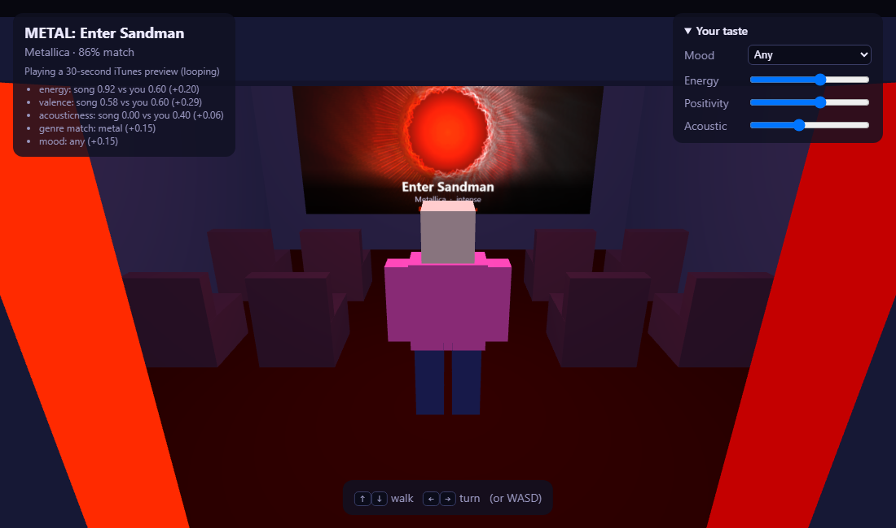

# 🎵 Music Recommender Simulation

## Project Summary

In this project you will build and explain a small music recommender system.

Your goal is to:

- Represent songs and a user "taste profile" as data
- Design a scoring rule that turns that data into recommendations
- Evaluate what your system gets right and wrong
- Reflect on how this mirrors real world AI recommenders

**What my version does.** It is a small content-based music recommender called VibeFinder 1.0. It reads 20 songs from a CSV file and scores each one against a user's taste profile (genre, mood, energy, valence and acousticness). It then returns the top 5 songs with a short, point-by-point explanation of each score. I tested it with 12 profiles, including adversarial ones, and ran a weight experiment. Findings are in the [Model Card](model_card.md).

---

## Genre Hallway (3D game)

A small 3D game built on the recommender: walk a character down a hallway with one room per genre. Each room is a mini movie theater. Step inside and the song the recommender picks for that genre plays, with a live audio visualizer on the screen and a "why" panel listing the score breakdown. The "Your taste" panel (mood, energy, positivity, acoustic) re-ranks every room's pick live.

| Hallway | Latin room (tropical colors) | Metal room (reds) |
|---|---|---|
|  |  |  |

(Screenshots captured from the running game with the real iTunes preview audio playing.)

**Where things live**

```
game/index.html          the page (loads everything from assets/)
assets/
  css/style.css          page and panel styling
  js/config.js           shared settings, ?mute debug flag
  js/palettes.js         per-genre color palettes
  js/recommender.js      taste profile + scoring (JS port of src/recommender.py)
  js/audio.js            iTunes preview lookup + audio engine
  js/world.js            3D hallway, rooms, character, collision
  js/visualizer.js       the psychedelic visualizer + theater screens
  js/game.js             input, info/taste panels, main loop
  data/game_data.js      generated song data (python -m src.export_game_data)
  images/                README screenshots
data/game_songs.csv      the 100-song catalog (source of truth for the game)
src/serve_game.py        local server: serves the page at / and assets/ at /assets/
```

```bash
python -m src.export_game_data     # writes assets/data/game_data.js from data/game_songs.csv
python -m src.check_previews       # optional: confirms each song has an iTunes preview
```

Then start the game (this serves it at http://localhost:8000 and opens your browser):

```bash
python -m src.serve_game
```

Do **not** just double-click `game/index.html`: browsers block a page opened from disk from calling the iTunes API, so no song would play (the game shows an error explaining this). It needs internet for Three.js and the previews. Controls: arrow keys or WASD. Click or press Enter to start (browsers need a click before they allow audio).

Notes:

- **Real music:** each room plays the 30-second preview clip of its pick, looked up from the iTunes Search API by title and artist (original recordings are preferred over remixes and covers). Apple's preview files allow cross-origin analysis, so the visualizer reacts to the actual audio. If a clip can't be found or loaded, the room plays nothing and the info panel says why (no fake sounds).
- **Catalog:** the game uses `data/game_songs.csv` (100 real songs across 13 genres, 7 to 9 per genre; each room plays the one that best fits your taste sliders). To add a song, append a row and run `python -m src.check_previews` to confirm iTunes has a clip; if text search can't find it, put its iTunes track id in the optional `itunes_track_id` column. The fictional `data/songs.csv` still belongs to the original recommender and is unchanged. The energy, valence, tempo, danceability and acousticness values in `game_songs.csv` are my hand estimates, not measured audio features.
- **Visualizer:** a feedback-trail kaleidoscope (waveform wedges, spectrum spokes, beat particles). Colors follow the genre: latin is tropical orange/yellow/pink, rock and metal are reds, ambient is deep blue, teal and forest green, reggae is red/gold/green, and so on (see `PALETTES` in `assets/js/palettes.js`).
- The scoring in `assets/js/recommender.js` is a JavaScript port of `score_song` in `src/recommender.py`. If you change the weights there, change them in the game too.
- Debug options: `index.html?autostart&room=3` skips the title screen and teleports into room 3; add `&mute` to skip audio (the visualizer then runs on a fake signal).

---

## How The System Works

There are many ways that AI recommendation systems work at YouTube, TikTok, and Spotify, and although they may not use the same recommendation system, the properties and attributes that make up their systems often have a lot of overlap. At a high-level, recommendation systems often have content-based filtering, that is, matching content attributes like mood, genre, energy to user taste profile. Another way these algorithms recommend content is collaborative-filtering, that is, using engagement behavior between user profiles to recommend content. 

For this project, I will start with a simple content-based approach to match songs to a user's taste profile. It is a better fit here than collaborative filtering because my dataset describes songs by their attributes but has no multi-user engagement data, and content-based methods work with less user activity. Each song attribute (energy, valence, acousticness, mood, genre) gets a 0-to-1 score for how closely it matches the user's target for that attribute: closeness for numeric attributes, and an exact match for categorical ones. The attribute scores are combined with weights into one match score per song, and the songs are then ranked by that score, with the top few returned along with a short explanation

The song attributes that will be used are: genre, mood, energy, valence, and acousticness to score a song

The UserProfile will store these same attributes as fields.

The five categories observed are given a score from 0 to 1. These categories are then weighted and each category score * weight is summed to reach one final song score. This represents how close the song matches the user taste profile.

The breakdown of attributes and weight is as follows:

| Attribute | Type | Closeness formula (0 to 1) | Weight |
|---|---|---|---|
| Energy | Numeric | `1 - abs(song_energy - target_energy)` | 30% |
| Valence | Numeric | `1 - abs(song_valence - target_valence)` | 30% |
| Genre | Categorical | `1` if `song_genre == favorite_genre`, else `0` | 15% |
| Mood | Categorical | `1` if `song_mood == favorite_mood`, else `0` | 15% |
| Acousticness | Numeric | `1 - abs(song_acousticness - acoustic_preference)` | 10% |

Energy and valence are given the highest weights because their attributes are independent from any strict rules or categorization. These two values can take us to the general region or direction a song is in, we can then refine it with the genre and mood categorization. This is so that songs that are in the same general vibe are not placed far apart due to similar genres not strictly matching each other. For example, Chill and Relaxed moods could be scored very different even though they are kind of the same thing. Acousticness was given the lowest weight simply because this is not as emphasized in real-world scenarios when it comes to exploring music in my experience. Of course this means some biases are introduced. Someone who prefers dubstep, house, and other electronic types of music may not immediately be given what they are looking for when it comes to the recommended songs. Furthermore, the algorithm may recommend different types of genres and moods to users who prefer to remain within a genre or particular mood. Thus someone who preferes high energy metal music, may also be recommended high energy pop which is almost the opposite of what a lot of real world metal fans like.
---

## Getting Started

### Setup

1. Create a virtual environment (optional but recommended):

   ```bash
   python -m venv .venv
   source .venv/bin/activate      # Mac or Linux
   .venv\Scripts\activate         # Windows
   ```

2. Install dependencies

```bash
pip install -r requirements.txt
```

3. Run the app:

```bash
python -m src.main
```

### Running Tests

Run the tests with:

```bash
pytest
```


---

## Sample Recommendation Output

Output of `python -m src.main` (default weights) for all 12 profiles. The first four are normal taste profiles; the rest are adversarial or edge-case profiles. Each block is the exact terminal output.

### Starter: Happy Pop - Top 5

```
========================================================================
                       STARTER: HAPPY POP - TOP 5                       
========================================================================
Tests:   baseline example
Profile: genre='pop', mood='happy', energy=0.8, valence=0.9, acousticness=0.6

------------------------------------------------------------------------
#1  Sunrise City  by Neon Echo  [pop/happy]
    Score: 0.93 / 1.00   [################### ]
    Why:
      - energy closeness 0.98 (song 0.82 vs target 0.80) (+0.29)
      - valence closeness 0.94 (song 0.84 vs target 0.90) (+0.28)
      - acousticness closeness 0.58 (song 0.18 vs target 0.60) (+0.06)
      - genre match: pop (+0.15)
      - mood match: happy (+0.15)

------------------------------------------------------------------------
#2  Rooftop Lights  by Indigo Parade  [indie pop/happy]
    Score: 0.79 / 1.00   [################    ]
    Why:
      - energy closeness 0.96 (song 0.76 vs target 0.80) (+0.29)
      - valence closeness 0.91 (song 0.81 vs target 0.90) (+0.27)
      - acousticness closeness 0.75 (song 0.35 vs target 0.60) (+0.08)
      - genre mismatch: indie pop vs pop (+0.00)
      - mood match: happy (+0.15)

------------------------------------------------------------------------
#3  Island Breeze  by Jah Sunrise  [reggae/happy]
    Score: 0.75 / 1.00   [###############     ]
    Why:
      - energy closeness 0.78 (song 0.58 vs target 0.80) (+0.23)
      - valence closeness 0.96 (song 0.86 vs target 0.90) (+0.29)
      - acousticness closeness 0.80 (song 0.40 vs target 0.60) (+0.08)
      - genre mismatch: reggae vs pop (+0.00)
      - mood match: happy (+0.15)

------------------------------------------------------------------------
#4  Pulse Horizon  by Helix Drop  [pop/euphoric]
    Score: 0.75 / 1.00   [###############     ]
    Why:
      - energy closeness 0.85 (song 0.95 vs target 0.80) (+0.26)
      - valence closeness 1.00 (song 0.90 vs target 0.90) (+0.30)
      - acousticness closeness 0.43 (song 0.03 vs target 0.60) (+0.04)
      - genre match: pop (+0.15)
      - mood mismatch: euphoric vs happy (+0.00)

------------------------------------------------------------------------
#5  Gym Hero  by Max Pulse  [pop/intense]
    Score: 0.72 / 1.00   [##############      ]
    Why:
      - energy closeness 0.87 (song 0.93 vs target 0.80) (+0.26)
      - valence closeness 0.87 (song 0.77 vs target 0.90) (+0.26)
      - acousticness closeness 0.45 (song 0.05 vs target 0.60) (+0.05)
      - genre match: pop (+0.15)
      - mood mismatch: intense vs happy (+0.00)

========================================================================
```

### High-Energy Pop - Top 5

```
========================================================================
                        HIGH-ENERGY POP - TOP 5                         
========================================================================
Tests:   upbeat, electronic, danceable
Profile: genre='pop', mood='euphoric', energy=0.95, valence=0.85, acousticness=0.1

------------------------------------------------------------------------
#1  Pulse Horizon  by Helix Drop  [pop/euphoric]
    Score: 0.98 / 1.00   [####################]
    Why:
      - energy closeness 1.00 (song 0.95 vs target 0.95) (+0.30)
      - valence closeness 0.95 (song 0.90 vs target 0.85) (+0.28)
      - acousticness closeness 0.93 (song 0.03 vs target 0.10) (+0.09)
      - genre match: pop (+0.15)
      - mood match: euphoric (+0.15)

------------------------------------------------------------------------
#2  Gym Hero  by Max Pulse  [pop/intense]
    Score: 0.81 / 1.00   [################    ]
    Why:
      - energy closeness 0.98 (song 0.93 vs target 0.95) (+0.29)
      - valence closeness 0.92 (song 0.77 vs target 0.85) (+0.28)
      - acousticness closeness 0.95 (song 0.05 vs target 0.10) (+0.10)
      - genre match: pop (+0.15)
      - mood mismatch: intense vs euphoric (+0.00)

------------------------------------------------------------------------
#3  Sunrise City  by Neon Echo  [pop/happy]
    Score: 0.80 / 1.00   [################    ]
    Why:
      - energy closeness 0.87 (song 0.82 vs target 0.95) (+0.26)
      - valence closeness 0.99 (song 0.84 vs target 0.85) (+0.30)
      - acousticness closeness 0.92 (song 0.18 vs target 0.10) (+0.09)
      - genre match: pop (+0.15)
      - mood mismatch: happy vs euphoric (+0.00)

------------------------------------------------------------------------
#4  Fuego en la Calle  by Los Cometas  [latin/energetic]
    Score: 0.66 / 1.00   [#############       ]
    Why:
      - energy closeness 0.93 (song 0.88 vs target 0.95) (+0.28)
      - valence closeness 0.96 (song 0.89 vs target 0.85) (+0.29)
      - acousticness closeness 0.95 (song 0.15 vs target 0.10) (+0.10)
      - genre mismatch: latin vs pop (+0.00)
      - mood mismatch: energetic vs euphoric (+0.00)

------------------------------------------------------------------------
#5  Rooftop Lights  by Indigo Parade  [indie pop/happy]
    Score: 0.61 / 1.00   [############        ]
    Why:
      - energy closeness 0.81 (song 0.76 vs target 0.95) (+0.24)
      - valence closeness 0.96 (song 0.81 vs target 0.85) (+0.29)
      - acousticness closeness 0.75 (song 0.35 vs target 0.10) (+0.08)
      - genre mismatch: indie pop vs pop (+0.00)
      - mood mismatch: happy vs euphoric (+0.00)

========================================================================
```

### Chill Lofi - Top 5

```
========================================================================
                           CHILL LOFI - TOP 5                           
========================================================================
Tests:   low energy, mellow, fairly acoustic
Profile: genre='lofi', mood='chill', energy=0.3, valence=0.55, acousticness=0.8

------------------------------------------------------------------------
#1  Library Rain  by Paper Lanterns  [lofi/chill]
    Score: 0.96 / 1.00   [################### ]
    Why:
      - energy closeness 0.95 (song 0.35 vs target 0.30) (+0.28)
      - valence closeness 0.95 (song 0.60 vs target 0.55) (+0.29)
      - acousticness closeness 0.94 (song 0.86 vs target 0.80) (+0.09)
      - genre match: lofi (+0.15)
      - mood match: chill (+0.15)

------------------------------------------------------------------------
#2  Midnight Coding  by LoRoom  [lofi/chill]
    Score: 0.95 / 1.00   [################### ]
    Why:
      - energy closeness 0.88 (song 0.42 vs target 0.30) (+0.26)
      - valence closeness 0.99 (song 0.56 vs target 0.55) (+0.30)
      - acousticness closeness 0.91 (song 0.71 vs target 0.80) (+0.09)
      - genre match: lofi (+0.15)
      - mood match: chill (+0.15)

------------------------------------------------------------------------
#3  Focus Flow  by LoRoom  [lofi/focused]
    Score: 0.81 / 1.00   [################    ]
    Why:
      - energy closeness 0.90 (song 0.40 vs target 0.30) (+0.27)
      - valence closeness 0.96 (song 0.59 vs target 0.55) (+0.29)
      - acousticness closeness 0.98 (song 0.78 vs target 0.80) (+0.10)
      - genre match: lofi (+0.15)
      - mood mismatch: focused vs chill (+0.00)

------------------------------------------------------------------------
#4  Spacewalk Thoughts  by Orbit Bloom  [ambient/chill]
    Score: 0.80 / 1.00   [################    ]
    Why:
      - energy closeness 0.98 (song 0.28 vs target 0.30) (+0.29)
      - valence closeness 0.90 (song 0.65 vs target 0.55) (+0.27)
      - acousticness closeness 0.88 (song 0.92 vs target 0.80) (+0.09)
      - genre mismatch: ambient vs lofi (+0.00)
      - mood match: chill (+0.15)

------------------------------------------------------------------------
#5  Moonlit Sonata  by Elena Varga  [classical/chill]
    Score: 0.80 / 1.00   [################    ]
    Why:
      - energy closeness 0.88 (song 0.18 vs target 0.30) (+0.26)
      - valence closeness 1.00 (song 0.55 vs target 0.55) (+0.30)
      - acousticness closeness 0.83 (song 0.97 vs target 0.80) (+0.08)
      - genre mismatch: classical vs lofi (+0.00)
      - mood match: chill (+0.15)

========================================================================
```

### Deep Intense Rock - Top 5

```
========================================================================
                       DEEP INTENSE ROCK - TOP 5                        
========================================================================
Tests:   loud, aggressive, dark, not acoustic
Profile: genre='rock', mood='intense', energy=0.92, valence=0.3, acousticness=0.1

------------------------------------------------------------------------
#1  Iron Cathedral  by Black Tide Rising  [rock/intense]
    Score: 0.96 / 1.00   [################### ]
    Why:
      - energy closeness 0.95 (song 0.97 vs target 0.92) (+0.29)
      - valence closeness 0.95 (song 0.25 vs target 0.30) (+0.28)
      - acousticness closeness 0.94 (song 0.04 vs target 0.10) (+0.09)
      - genre match: rock (+0.15)
      - mood match: intense (+0.15)

------------------------------------------------------------------------
#2  Storm Runner  by Voltline  [rock/intense]
    Score: 0.94 / 1.00   [################### ]
    Why:
      - energy closeness 0.99 (song 0.91 vs target 0.92) (+0.30)
      - valence closeness 0.82 (song 0.48 vs target 0.30) (+0.25)
      - acousticness closeness 1.00 (song 0.10 vs target 0.10) (+0.10)
      - genre match: rock (+0.15)
      - mood match: intense (+0.15)

------------------------------------------------------------------------
#3  Gym Hero  by Max Pulse  [pop/intense]
    Score: 0.70 / 1.00   [##############      ]
    Why:
      - energy closeness 0.99 (song 0.93 vs target 0.92) (+0.30)
      - valence closeness 0.53 (song 0.77 vs target 0.30) (+0.16)
      - acousticness closeness 0.95 (song 0.05 vs target 0.10) (+0.10)
      - genre mismatch: pop vs rock (+0.00)
      - mood match: intense (+0.15)

------------------------------------------------------------------------
#4  Night Drive Loop  by Neon Echo  [synthwave/moody]
    Score: 0.58 / 1.00   [############        ]
    Why:
      - energy closeness 0.83 (song 0.75 vs target 0.92) (+0.25)
      - valence closeness 0.81 (song 0.49 vs target 0.30) (+0.24)
      - acousticness closeness 0.88 (song 0.22 vs target 0.10) (+0.09)
      - genre mismatch: synthwave vs rock (+0.00)
      - mood mismatch: moody vs intense (+0.00)

------------------------------------------------------------------------
#5  Concrete Crown  by Kid Meridian  [hip hop/confident]
    Score: 0.56 / 1.00   [###########         ]
    Why:
      - energy closeness 0.86 (song 0.78 vs target 0.92) (+0.26)
      - valence closeness 0.68 (song 0.62 vs target 0.30) (+0.20)
      - acousticness closeness 0.98 (song 0.12 vs target 0.10) (+0.10)
      - genre mismatch: hip hop vs rock (+0.00)
      - mood mismatch: confident vs intense (+0.00)

========================================================================
```

### Conflict: Energetic But Sad - Top 5

```
========================================================================
                  CONFLICT: ENERGETIC BUT SAD - TOP 5                   
========================================================================
Tests:   high energy + 'sad' mood; no song has mood 'sad', so mood can never match
Profile: genre='pop', mood='sad', energy=0.9, valence=0.1, acousticness=0.5

------------------------------------------------------------------------
#1  Gym Hero  by Max Pulse  [pop/intense]
    Score: 0.59 / 1.00   [############        ]
    Why:
      - energy closeness 0.97 (song 0.93 vs target 0.90) (+0.29)
      - valence closeness 0.33 (song 0.77 vs target 0.10) (+0.10)
      - acousticness closeness 0.55 (song 0.05 vs target 0.50) (+0.06)
      - genre match: pop (+0.15)
      - mood mismatch: intense vs sad (+0.00)

------------------------------------------------------------------------
#2  Iron Cathedral  by Black Tide Rising  [rock/intense]
    Score: 0.59 / 1.00   [############        ]
    Why:
      - energy closeness 0.93 (song 0.97 vs target 0.90) (+0.28)
      - valence closeness 0.85 (song 0.25 vs target 0.10) (+0.26)
      - acousticness closeness 0.54 (song 0.04 vs target 0.50) (+0.05)
      - genre mismatch: rock vs pop (+0.00)
      - mood mismatch: intense vs sad (+0.00)

------------------------------------------------------------------------
#3  Sunrise City  by Neon Echo  [pop/happy]
    Score: 0.57 / 1.00   [###########         ]
    Why:
      - energy closeness 0.92 (song 0.82 vs target 0.90) (+0.28)
      - valence closeness 0.26 (song 0.84 vs target 0.10) (+0.08)
      - acousticness closeness 0.68 (song 0.18 vs target 0.50) (+0.07)
      - genre match: pop (+0.15)
      - mood mismatch: happy vs sad (+0.00)

------------------------------------------------------------------------
#4  Pulse Horizon  by Helix Drop  [pop/euphoric]
    Score: 0.55 / 1.00   [###########         ]
    Why:
      - energy closeness 0.95 (song 0.95 vs target 0.90) (+0.29)
      - valence closeness 0.20 (song 0.90 vs target 0.10) (+0.06)
      - acousticness closeness 0.53 (song 0.03 vs target 0.50) (+0.05)
      - genre match: pop (+0.15)
      - mood mismatch: euphoric vs sad (+0.00)

------------------------------------------------------------------------
#5  Storm Runner  by Voltline  [rock/intense]
    Score: 0.54 / 1.00   [###########         ]
    Why:
      - energy closeness 0.99 (song 0.91 vs target 0.90) (+0.30)
      - valence closeness 0.62 (song 0.48 vs target 0.10) (+0.19)
      - acousticness closeness 0.60 (song 0.10 vs target 0.50) (+0.06)
      - genre mismatch: rock vs pop (+0.00)
      - mood mismatch: intense vs sad (+0.00)

========================================================================
```

### Conflict: Calm Metal Fan - Top 5

```
========================================================================
                    CONFLICT: CALM METAL FAN - TOP 5                    
========================================================================
Tests:   genre/mood say aggressive, numbers say quiet and acoustic
Profile: genre='rock', mood='intense', energy=0.1, valence=0.5, acousticness=0.95

------------------------------------------------------------------------
#1  Storm Runner  by Voltline  [rock/intense]
    Score: 0.67 / 1.00   [#############       ]
    Why:
      - energy closeness 0.19 (song 0.91 vs target 0.10) (+0.06)
      - valence closeness 0.98 (song 0.48 vs target 0.50) (+0.29)
      - acousticness closeness 0.15 (song 0.10 vs target 0.95) (+0.02)
      - genre match: rock (+0.15)
      - mood match: intense (+0.15)

------------------------------------------------------------------------
#2  Moonlit Sonata  by Elena Varga  [classical/chill]
    Score: 0.66 / 1.00   [#############       ]
    Why:
      - energy closeness 0.92 (song 0.18 vs target 0.10) (+0.28)
      - valence closeness 0.95 (song 0.55 vs target 0.50) (+0.28)
      - acousticness closeness 0.98 (song 0.97 vs target 0.95) (+0.10)
      - genre mismatch: classical vs rock (+0.00)
      - mood mismatch: chill vs intense (+0.00)

------------------------------------------------------------------------
#3  Spacewalk Thoughts  by Orbit Bloom  [ambient/chill]
    Score: 0.60 / 1.00   [############        ]
    Why:
      - energy closeness 0.82 (song 0.28 vs target 0.10) (+0.25)
      - valence closeness 0.85 (song 0.65 vs target 0.50) (+0.26)
      - acousticness closeness 0.97 (song 0.92 vs target 0.95) (+0.10)
      - genre mismatch: ambient vs rock (+0.00)
      - mood mismatch: chill vs intense (+0.00)

------------------------------------------------------------------------
#4  Library Rain  by Paper Lanterns  [lofi/chill]
    Score: 0.59 / 1.00   [############        ]
    Why:
      - energy closeness 0.75 (song 0.35 vs target 0.10) (+0.22)
      - valence closeness 0.90 (song 0.60 vs target 0.50) (+0.27)
      - acousticness closeness 0.91 (song 0.86 vs target 0.95) (+0.09)
      - genre mismatch: lofi vs rock (+0.00)
      - mood mismatch: chill vs intense (+0.00)

------------------------------------------------------------------------
#5  Iron Cathedral  by Black Tide Rising  [rock/intense]
    Score: 0.57 / 1.00   [###########         ]
    Why:
      - energy closeness 0.13 (song 0.97 vs target 0.10) (+0.04)
      - valence closeness 0.75 (song 0.25 vs target 0.50) (+0.22)
      - acousticness closeness 0.09 (song 0.04 vs target 0.95) (+0.01)
      - genre match: rock (+0.15)
      - mood match: intense (+0.15)

========================================================================
```

### Unknown Genre - Top 5

```
========================================================================
                         UNKNOWN GENRE - TOP 5                          
========================================================================
Tests:   genre not in the catalog ('k-pop'); does the 0.15 genre weight just vanish?
Profile: genre='k-pop', mood='happy', energy=0.8, valence=0.8, acousticness=0.3

------------------------------------------------------------------------
#1  Rooftop Lights  by Indigo Parade  [indie pop/happy]
    Score: 0.83 / 1.00   [#################   ]
    Why:
      - energy closeness 0.96 (song 0.76 vs target 0.80) (+0.29)
      - valence closeness 0.99 (song 0.81 vs target 0.80) (+0.30)
      - acousticness closeness 0.95 (song 0.35 vs target 0.30) (+0.10)
      - genre mismatch: indie pop vs k-pop (+0.00)
      - mood match: happy (+0.15)

------------------------------------------------------------------------
#2  Sunrise City  by Neon Echo  [pop/happy]
    Score: 0.82 / 1.00   [################    ]
    Why:
      - energy closeness 0.98 (song 0.82 vs target 0.80) (+0.29)
      - valence closeness 0.96 (song 0.84 vs target 0.80) (+0.29)
      - acousticness closeness 0.88 (song 0.18 vs target 0.30) (+0.09)
      - genre mismatch: pop vs k-pop (+0.00)
      - mood match: happy (+0.15)

------------------------------------------------------------------------
#3  Island Breeze  by Jah Sunrise  [reggae/happy]
    Score: 0.76 / 1.00   [###############     ]
    Why:
      - energy closeness 0.78 (song 0.58 vs target 0.80) (+0.23)
      - valence closeness 0.94 (song 0.86 vs target 0.80) (+0.28)
      - acousticness closeness 0.90 (song 0.40 vs target 0.30) (+0.09)
      - genre mismatch: reggae vs k-pop (+0.00)
      - mood match: happy (+0.15)

------------------------------------------------------------------------
#4  Fuego en la Calle  by Los Cometas  [latin/energetic]
    Score: 0.63 / 1.00   [#############       ]
    Why:
      - energy closeness 0.92 (song 0.88 vs target 0.80) (+0.28)
      - valence closeness 0.91 (song 0.89 vs target 0.80) (+0.27)
      - acousticness closeness 0.85 (song 0.15 vs target 0.30) (+0.09)
      - genre mismatch: latin vs k-pop (+0.00)
      - mood mismatch: energetic vs happy (+0.00)

------------------------------------------------------------------------
#5  Gym Hero  by Max Pulse  [pop/intense]
    Score: 0.63 / 1.00   [#############       ]
    Why:
      - energy closeness 0.87 (song 0.93 vs target 0.80) (+0.26)
      - valence closeness 0.97 (song 0.77 vs target 0.80) (+0.29)
      - acousticness closeness 0.75 (song 0.05 vs target 0.30) (+0.08)
      - genre mismatch: pop vs k-pop (+0.00)
      - mood mismatch: intense vs happy (+0.00)

========================================================================
```

### Out-Of-Range Numbers - Top 5

```
========================================================================
                      OUT-OF-RANGE NUMBERS - TOP 5                      
========================================================================
Tests:   energy=1.5 and acousticness=-0.5 are impossible; closeness can go below zero
Profile: genre='pop', mood='happy', energy=1.5, valence=0.9, acousticness=-0.5

------------------------------------------------------------------------
#1  Sunrise City  by Neon Echo  [pop/happy]
    Score: 0.71 / 1.00   [##############      ]
    Why:
      - energy closeness 0.32 (song 0.82 vs target 1.50) (+0.10)
      - valence closeness 0.94 (song 0.84 vs target 0.90) (+0.28)
      - acousticness closeness 0.32 (song 0.18 vs target -0.50) (+0.03)
      - genre match: pop (+0.15)
      - mood match: happy (+0.15)

------------------------------------------------------------------------
#2  Pulse Horizon  by Helix Drop  [pop/euphoric]
    Score: 0.63 / 1.00   [#############       ]
    Why:
      - energy closeness 0.45 (song 0.95 vs target 1.50) (+0.13)
      - valence closeness 1.00 (song 0.90 vs target 0.90) (+0.30)
      - acousticness closeness 0.47 (song 0.03 vs target -0.50) (+0.05)
      - genre match: pop (+0.15)
      - mood mismatch: euphoric vs happy (+0.00)

------------------------------------------------------------------------
#3  Gym Hero  by Max Pulse  [pop/intense]
    Score: 0.58 / 1.00   [############        ]
    Why:
      - energy closeness 0.43 (song 0.93 vs target 1.50) (+0.13)
      - valence closeness 0.87 (song 0.77 vs target 0.90) (+0.26)
      - acousticness closeness 0.45 (song 0.05 vs target -0.50) (+0.04)
      - genre match: pop (+0.15)
      - mood mismatch: intense vs happy (+0.00)

------------------------------------------------------------------------
#4  Rooftop Lights  by Indigo Parade  [indie pop/happy]
    Score: 0.52 / 1.00   [##########          ]
    Why:
      - energy closeness 0.26 (song 0.76 vs target 1.50) (+0.08)
      - valence closeness 0.91 (song 0.81 vs target 0.90) (+0.27)
      - acousticness closeness 0.15 (song 0.35 vs target -0.50) (+0.02)
      - genre mismatch: indie pop vs pop (+0.00)
      - mood match: happy (+0.15)

------------------------------------------------------------------------
#5  Island Breeze  by Jah Sunrise  [reggae/happy]
    Score: 0.47 / 1.00   [#########           ]
    Why:
      - energy closeness 0.08 (song 0.58 vs target 1.50) (+0.02)
      - valence closeness 0.96 (song 0.86 vs target 0.90) (+0.29)
      - acousticness closeness 0.10 (song 0.40 vs target -0.50) (+0.01)
      - genre mismatch: reggae vs pop (+0.00)
      - mood match: happy (+0.15)

========================================================================
```

### Dead Center - Top 5

```
========================================================================
                          DEAD CENTER - TOP 5                           
========================================================================
Tests:   every numeric target is 0.5, so many songs should tie
Profile: genre='jazz', mood='relaxed', energy=0.5, valence=0.5, acousticness=0.5

------------------------------------------------------------------------
#1  Coffee Shop Stories  by Slow Stereo  [jazz/relaxed]
    Score: 0.86 / 1.00   [#################   ]
    Why:
      - energy closeness 0.87 (song 0.37 vs target 0.50) (+0.26)
      - valence closeness 0.79 (song 0.71 vs target 0.50) (+0.24)
      - acousticness closeness 0.61 (song 0.89 vs target 0.50) (+0.06)
      - genre match: jazz (+0.15)
      - mood match: relaxed (+0.15)

------------------------------------------------------------------------
#2  Late Set Smoke  by Fern & Ash  [jazz/moody]
    Score: 0.79 / 1.00   [################    ]
    Why:
      - energy closeness 0.95 (song 0.45 vs target 0.50) (+0.28)
      - valence closeness 0.95 (song 0.45 vs target 0.50) (+0.28)
      - acousticness closeness 0.70 (song 0.80 vs target 0.50) (+0.07)
      - genre match: jazz (+0.15)
      - mood mismatch: moody vs relaxed (+0.00)

------------------------------------------------------------------------
#3  Dust Road Home  by Willow Creek Band  [country/relaxed]
    Score: 0.77 / 1.00   [###############     ]
    Why:
      - energy closeness 0.98 (song 0.48 vs target 0.50) (+0.29)
      - valence closeness 0.82 (song 0.68 vs target 0.50) (+0.25)
      - acousticness closeness 0.76 (song 0.74 vs target 0.50) (+0.08)
      - genre mismatch: country vs jazz (+0.00)
      - mood match: relaxed (+0.15)

------------------------------------------------------------------------
#4  Midnight Coding  by LoRoom  [lofi/chill]
    Score: 0.64 / 1.00   [#############       ]
    Why:
      - energy closeness 0.92 (song 0.42 vs target 0.50) (+0.28)
      - valence closeness 0.94 (song 0.56 vs target 0.50) (+0.28)
      - acousticness closeness 0.79 (song 0.71 vs target 0.50) (+0.08)
      - genre mismatch: lofi vs jazz (+0.00)
      - mood mismatch: chill vs relaxed (+0.00)

------------------------------------------------------------------------
#5  Velvet Evening  by Sade Monroe  [synthwave/romantic]
    Score: 0.62 / 1.00   [############        ]
    Why:
      - energy closeness 0.98 (song 0.52 vs target 0.50) (+0.29)
      - valence closeness 0.78 (song 0.72 vs target 0.50) (+0.23)
      - acousticness closeness 0.88 (song 0.38 vs target 0.50) (+0.09)
      - genre mismatch: synthwave vs jazz (+0.00)
      - mood mismatch: romantic vs relaxed (+0.00)

========================================================================
```

### Case/Whitespace Mismatch - Top 5

```
========================================================================
                    CASE/WHITESPACE MISMATCH - TOP 5                    
========================================================================
Tests:   'Lofi ' and 'CHILL' differ from 'lofi'/'chill' under exact matching
Profile: genre='Lofi ', mood='CHILL', energy=0.3, valence=0.55, acousticness=0.8

------------------------------------------------------------------------
#1  Library Rain  by Paper Lanterns  [lofi/chill]
    Score: 0.66 / 1.00   [#############       ]
    Why:
      - energy closeness 0.95 (song 0.35 vs target 0.30) (+0.28)
      - valence closeness 0.95 (song 0.60 vs target 0.55) (+0.29)
      - acousticness closeness 0.94 (song 0.86 vs target 0.80) (+0.09)
      - genre mismatch: lofi vs Lofi  (+0.00)
      - mood mismatch: chill vs CHILL (+0.00)

------------------------------------------------------------------------
#2  Focus Flow  by LoRoom  [lofi/focused]
    Score: 0.66 / 1.00   [#############       ]
    Why:
      - energy closeness 0.90 (song 0.40 vs target 0.30) (+0.27)
      - valence closeness 0.96 (song 0.59 vs target 0.55) (+0.29)
      - acousticness closeness 0.98 (song 0.78 vs target 0.80) (+0.10)
      - genre mismatch: lofi vs Lofi  (+0.00)
      - mood mismatch: focused vs CHILL (+0.00)

------------------------------------------------------------------------
#3  Midnight Coding  by LoRoom  [lofi/chill]
    Score: 0.65 / 1.00   [#############       ]
    Why:
      - energy closeness 0.88 (song 0.42 vs target 0.30) (+0.26)
      - valence closeness 0.99 (song 0.56 vs target 0.55) (+0.30)
      - acousticness closeness 0.91 (song 0.71 vs target 0.80) (+0.09)
      - genre mismatch: lofi vs Lofi  (+0.00)
      - mood mismatch: chill vs CHILL (+0.00)

------------------------------------------------------------------------
#4  Spacewalk Thoughts  by Orbit Bloom  [ambient/chill]
    Score: 0.65 / 1.00   [#############       ]
    Why:
      - energy closeness 0.98 (song 0.28 vs target 0.30) (+0.29)
      - valence closeness 0.90 (song 0.65 vs target 0.55) (+0.27)
      - acousticness closeness 0.88 (song 0.92 vs target 0.80) (+0.09)
      - genre mismatch: ambient vs Lofi  (+0.00)
      - mood mismatch: chill vs CHILL (+0.00)

------------------------------------------------------------------------
#5  Moonlit Sonata  by Elena Varga  [classical/chill]
    Score: 0.65 / 1.00   [#############       ]
    Why:
      - energy closeness 0.88 (song 0.18 vs target 0.30) (+0.26)
      - valence closeness 1.00 (song 0.55 vs target 0.55) (+0.30)
      - acousticness closeness 0.83 (song 0.97 vs target 0.80) (+0.08)
      - genre mismatch: classical vs Lofi  (+0.00)
      - mood mismatch: chill vs CHILL (+0.00)

========================================================================
```

### Empty Profile - Top 5

```
========================================================================
                         EMPTY PROFILE - TOP 5                          
========================================================================
Tests:   no preferences at all; every song should score 1.00
Profile: (empty)

------------------------------------------------------------------------
#1  Sunrise City  by Neon Echo  [pop/happy]
    Score: 1.00 / 1.00   [####################]
    Why:
      - energy closeness 1.00 (no preference, anything works) (+0.30)
      - valence closeness 1.00 (no preference, anything works) (+0.30)
      - acousticness closeness 1.00 (no preference, anything works) (+0.10)
      - genre no preference, anything works (+0.15)
      - mood no preference, anything works (+0.15)

------------------------------------------------------------------------
#2  Midnight Coding  by LoRoom  [lofi/chill]
    Score: 1.00 / 1.00   [####################]
    Why:
      - energy closeness 1.00 (no preference, anything works) (+0.30)
      - valence closeness 1.00 (no preference, anything works) (+0.30)
      - acousticness closeness 1.00 (no preference, anything works) (+0.10)
      - genre no preference, anything works (+0.15)
      - mood no preference, anything works (+0.15)

------------------------------------------------------------------------
#3  Storm Runner  by Voltline  [rock/intense]
    Score: 1.00 / 1.00   [####################]
    Why:
      - energy closeness 1.00 (no preference, anything works) (+0.30)
      - valence closeness 1.00 (no preference, anything works) (+0.30)
      - acousticness closeness 1.00 (no preference, anything works) (+0.10)
      - genre no preference, anything works (+0.15)
      - mood no preference, anything works (+0.15)

------------------------------------------------------------------------
#4  Library Rain  by Paper Lanterns  [lofi/chill]
    Score: 1.00 / 1.00   [####################]
    Why:
      - energy closeness 1.00 (no preference, anything works) (+0.30)
      - valence closeness 1.00 (no preference, anything works) (+0.30)
      - acousticness closeness 1.00 (no preference, anything works) (+0.10)
      - genre no preference, anything works (+0.15)
      - mood no preference, anything works (+0.15)

------------------------------------------------------------------------
#5  Gym Hero  by Max Pulse  [pop/intense]
    Score: 1.00 / 1.00   [####################]
    Why:
      - energy closeness 1.00 (no preference, anything works) (+0.30)
      - valence closeness 1.00 (no preference, anything works) (+0.30)
      - acousticness closeness 1.00 (no preference, anything works) (+0.10)
      - genre no preference, anything works (+0.15)
      - mood no preference, anything works (+0.15)

========================================================================
```

### Genre Only - Top 5

```
========================================================================
                           GENRE ONLY - TOP 5                           
========================================================================
Tests:   only genre given; unspecified fields count as a perfect match
Profile: genre='classical'

------------------------------------------------------------------------
#1  Moonlit Sonata  by Elena Varga  [classical/chill]
    Score: 1.00 / 1.00   [####################]
    Why:
      - energy closeness 1.00 (no preference, anything works) (+0.30)
      - valence closeness 1.00 (no preference, anything works) (+0.30)
      - acousticness closeness 1.00 (no preference, anything works) (+0.10)
      - genre match: classical (+0.15)
      - mood no preference, anything works (+0.15)

------------------------------------------------------------------------
#2  Sunrise City  by Neon Echo  [pop/happy]
    Score: 0.85 / 1.00   [#################   ]
    Why:
      - energy closeness 1.00 (no preference, anything works) (+0.30)
      - valence closeness 1.00 (no preference, anything works) (+0.30)
      - acousticness closeness 1.00 (no preference, anything works) (+0.10)
      - genre mismatch: pop vs classical (+0.00)
      - mood no preference, anything works (+0.15)

------------------------------------------------------------------------
#3  Midnight Coding  by LoRoom  [lofi/chill]
    Score: 0.85 / 1.00   [#################   ]
    Why:
      - energy closeness 1.00 (no preference, anything works) (+0.30)
      - valence closeness 1.00 (no preference, anything works) (+0.30)
      - acousticness closeness 1.00 (no preference, anything works) (+0.10)
      - genre mismatch: lofi vs classical (+0.00)
      - mood no preference, anything works (+0.15)

------------------------------------------------------------------------
#4  Storm Runner  by Voltline  [rock/intense]
    Score: 0.85 / 1.00   [#################   ]
    Why:
      - energy closeness 1.00 (no preference, anything works) (+0.30)
      - valence closeness 1.00 (no preference, anything works) (+0.30)
      - acousticness closeness 1.00 (no preference, anything works) (+0.10)
      - genre mismatch: rock vs classical (+0.00)
      - mood no preference, anything works (+0.15)

------------------------------------------------------------------------
#5  Library Rain  by Paper Lanterns  [lofi/chill]
    Score: 0.85 / 1.00   [#################   ]
    Why:
      - energy closeness 1.00 (no preference, anything works) (+0.30)
      - valence closeness 1.00 (no preference, anything works) (+0.30)
      - acousticness closeness 1.00 (no preference, anything works) (+0.10)
      - genre mismatch: lofi vs classical (+0.00)
      - mood no preference, anything works (+0.15)

========================================================================
```


---

## Experiments You Tried

**Weight shift (energy x2, genre /2).** Energy goes from 0.30 to 0.60 and genre from 0.15 to 0.075. Those numbers add up to 1.225, so every weight is divided by 1.225 to make the total exactly 1.0 again (energy 0.49, valence 0.24, mood 0.12, acousticness 0.08, genre 0.06). A startup check in `recommender.py` asserts that the weights sum to 1.0. Run it with `RECOMMENDER_WEIGHTS=experiment python -m src.main` (PowerShell: `$env:RECOMMENDER_WEIGHTS="experiment"; python -m src.main`).

What changed:

- **Starter Happy Pop:** Gym Hero fell out of the top 5 and Fuego en la Calle (latin) came in. The top 3 stayed the same.
- **Energetic but Sad:** Gym Hero lost #1 to Iron Cathedral, a rock song, because energy now matters more.
- **Calm Metal Fan:** every rock song left the top 5, and Moonlit Sonata (classical) took #1.
- **Dead Center (asked for jazz):** a country song took #1 from the jazz song.
- **Chill Lofi, Deep Intense Rock, Empty and Genre Only:** barely changed.

Verdict: the results were different, not clearly more accurate. They matched the numeric targets better, but they ignored the genre the user explicitly asked for. Details are in the model card.

---

## Limitations and Risks

- It only works on a tiny catalog (20 songs), so a "top 5" is a quarter of everything.
- Genre and mood need an exact text match. A typo, a capital letter or a word not in the catalog ("sad", "k-pop") earns zero points, and the user is not told.
- A user who leaves a preference out is treated as a perfect match for it, so an empty profile gives every song 1.00 and the "ranking" is just file order.
- Energy is the same kind of number for every user, so it cannot express "high energy but sad".
- It does not understand lyrics, language, artist or tempo.

See the model card for more.

---

## Reflection

For the full write-up, see the model card:

[**Model Card**](model_card.md)

Building this showed me that a recommender turns data into predictions by comparing numbers. Each song gets a score from how close its energy, valence and acousticness are to what the user wants, plus points for matching genre and mood. Adding the weights up gives a ranking, and the weights decide what the system values. When I doubled energy and halved genre, the lists changed but were not clearly better. They fit the numbers more closely and ignored the genre some users asked for.

Bias can show up in quiet ways. With only 20 songs, some users get many good matches (lofi, loud pop) and others get one, then filler. Exact-match labels meant a mood like "sad" never matched, and the system did not say so. A single trailing space in "Lofi " cost 0.30 of a score. Songs like Gym Hero kept appearing for profiles that had nothing to do with it. In a real app, these gaps could mean some listeners are served much better than others without anyone noticing. More detail is in the [**Model Card**](model_card.md).
