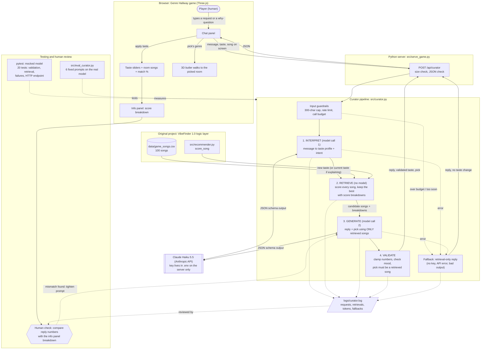

# System Diagram: Genre Hallway Curator

The diagram source is also in [system_diagram.mmd](system_diagram.mmd).

## How to read it

- **Input to process to output:** the player types in the chat panel. The server checks the request, then the Curator pipeline runs four steps: interpret, retrieve, generate, validate. The validated result goes back to the browser, which moves the taste sliders (so every room's song and match percentage change) and sends the butler to the picked genre's room.
- **Retrieval:** step 2 reuses `score_song` and the song catalog from the original VibeFinder 1.0 project. It is the only place songs are chosen; the model can only talk about what retrieval returned.
- **Where the AI is:** two calls to Claude Haiku 5.5, both with a JSON schema so the output is machine-readable. The API key stays on the server.
- **Dashed lines:** error paths and logging. If anything fails, the fallback gives a retrieval-only answer so the game keeps working.
- **Testing and humans:** `pytest` runs the pipeline against a mocked model (no key needed). `src/eval_curator.py` runs six fixed prompts on the real model. A human reads the log and compares the butler's numbers with the info panel's score breakdown; mismatches led to prompt changes (see the Testing Summary in the README).
